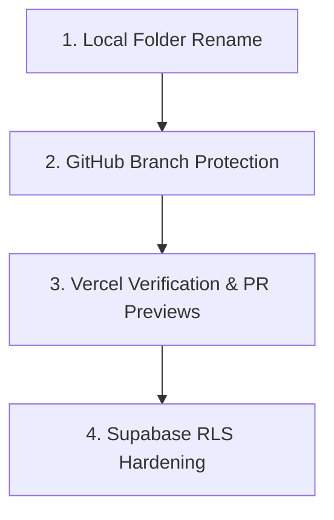

# Awrady — Remaining Platform & Security Setup Plan (To Finish Later)

This plan contains strictly the **remaining pending configuration and security tasks** to complete for Awrady. All completed setup tasks (License, README, Contributing guide, Templates, CI workflow, GitHub topics/discussions, and starter issues) have been removed.



---

## 1. 💻 Local Folder Rename (On Your Machine)

Since the active IDE session holds a lock on the root directory, complete this once you close the editor:
- [ ] Close the IDE / editor window.
- [ ] In Windows File Explorer (or PowerShell), rename `D:\projects\Enjaz` to **`D:\projects\Awrady`**.
- [ ] Reopen `D:\projects\Awrady` in your IDE.

---

## 2. 🐙 GitHub: Branch Protection for `main`

Protect the `main` branch from direct pushes and unverified code:
- [ ] Go to [Awrady Repository Settings](https://github.com/Mhmd7syn/Awrady/settings) → **Branches**.
- [ ] Click **Add branch protection rule** (or edit rule for `main`).
- [ ] Branch name pattern: `main`.
- [ ] Check: **Require a pull request before merging** (Require 1 approval).
- [ ] Check: **Require status checks to pass before merging**.
- [ ] In the search box, select the **`validate`** status check (from our `.github/workflows/ci.yml` syntax workflow).
- [ ] Click **Save changes**.

---

## 3. ▲ Vercel: Verification & Contributor PR Previews

Ensure deployments seamlessly reflect the new repository name and build previews for pull requests:
- [ ] Log in to [Vercel Dashboard](https://vercel.com/) → Open the **awrady** project.
- [ ] Go to **Settings** → **Git**:
  - Verify the connected repository reflects `Mhmd7syn/Awrady` (reconnect if still showing `awrad-ui`).
  - Verify **Automatically build Pull Requests** is **Enabled** (generates an instant live preview URL for every contributor's PR).
- [ ] Go to **Settings** → **Deployment Protection**:
  - Ensure external contributor/fork deployments require authorization before building (protects your build limits).

---

## 4. ⚡ Supabase: Security & Row-Level Security (RLS)

Secure your live Supabase database before community traffic arrives:
- [ ] **Decouple Credentials in Code**:
  - In `js/config/constants.js`, leave the public fallback credentials blank or dedicated to guest mode, so external contributors develop against offline `localStorage` without writing to your database.
- [ ] **Tighten RLS in Supabase SQL Editor**:
  - Run the following migration in your [Supabase SQL Editor](https://supabase.com/dashboard/project/krmatocnrjzivwpmbxgu/sql) to replace the open `USING (true)` policies with user-scoped isolation:
    ```sql
    -- 1. Remove open permissive policies
    DROP POLICY IF EXISTS "Allow access on tasks" ON public.tasks;
    DROP POLICY IF EXISTS "Allow access on daily_progress" ON public.daily_progress;

    -- 2. Isolate tasks to the matching user
    CREATE POLICY "User task isolation" ON public.tasks
        FOR ALL USING (username = coalesce(current_setting('request.jwt.claim.sub', true), username))
        WITH CHECK (username = coalesce(current_setting('request.jwt.claim.sub', true), username));

    -- 3. Isolate daily progress to the matching user
    CREATE POLICY "User progress isolation" ON public.daily_progress
        FOR ALL USING (username = coalesce(current_setting('request.jwt.claim.sub', true), username))
        WITH CHECK (username = coalesce(current_setting('request.jwt.claim.sub', true), username));
    ```
- [ ] **Database Backups**:
  - In Supabase Dashboard → **Database** → **Backups**, verify automatic daily backups are active.
